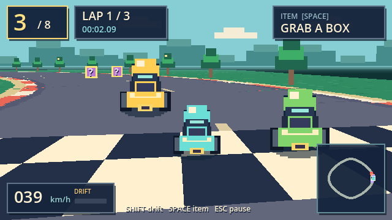
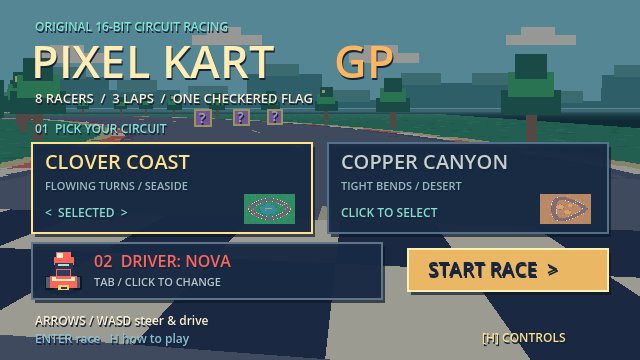

# Pixel Kart GP

**原创像素卡丁车竞速 · Godot 4.6.3 · Windows / macOS**

A complete little single-player, 16-bit-inspired kart racer: a real looping circuit, seven AI opponents, three laps, drifting, mini-turbos and item battles. Built with a perspective-projected **Mode 7-style ground plane** and original pixel art, rather than a straight/endless road.



## Play / 开始游戏

Download the Windows or macOS archive from this repository's **Releases** page. Extract the whole archive before launching.

- **Windows x86-64:** run `PixelKartGP.exe`. Keep the supplied files together.
- **macOS universal (Apple Silicon + Intel):** open `Pixel Kart GP.app`. The hobby build is unsigned and not notarized. macOS may require the standard Finder **Open** confirmation or **Privacy & Security → Open Anyway** after you verify the download. Do not disable Gatekeeper system-wide.
- **From source:** import `project.godot` in Godot **4.6.3**, then press **F6** on the main scene or **F5** to play. No plugins or asset downloads needed.

## Controls / 操作

| Action | Keyboard | Controller |
|---|---|---|
| Accelerate / 加速 | W / ↑ | A or RT |
| Brake / 刹车 | S / ↓ | B |
| Steer / 转向 | A D / ← → | Left stick |
| Drift / 漂移 | Hold Shift while steering | RB |
| Use item / 道具 | Space | X |
| Rescue / 回到赛道 (+3 seconds) | Backspace | — |
| Pause / 暂停 | Esc / P | Start |
| Restart / 重开 | R | — |
| Help / 帮助 | H / F1 | — |
| Mute / 静音 | M | — |

In the menu, **← / →** selects a circuit, **Tab / ↑ / ↓** cycles drivers, and **Enter** starts. Mouse selection also works. On controller, use the D-pad and Start. In the pause menu, **Q** returns to course selection. After a race, **Enter / R** retries and **Esc** returns to the menu.

## What's inside

- **Clover Coast:** a wide flowing waterside circuit.
- **Copper Canyon:** a more technical circuit with sharper bends.
- Eight original color-themed drivers: Nova, Mint, Luna, Spark, Fern, Cobalt, Rosie and Ember. Drivers are cosmetic choices with equal player handling.
- Seven AI karts that steer along the circuit, collect and use items, collide, spin and finish their own laps.
- Ordered checkpoints and directional start-line crossing. Grass slows you down; cutting across the infield cannot skip all the checkpoints.
- Hold a turning drift until the sparks turn blue, then release for a **mini-turbo**.
- **BOOST** gives a speed burst, **BOLT** fires a projectile ahead, **OIL** drops a trap behind. Collect the floating question boxes, then press Space.
- Live position, lap/time display, minimap, speedometer, countdown, pause, results and saved best times per course.
- Original synthesized chiptune melody, engine tone and event sounds. Sound can be muted.
- 640×360 internal render target, nearest-neighbor sprites and pixel-textured ground. Resizes to your window.



## Development

```sh
godot --headless --path . --editor --import --quit
godot --headless --path . --script tests/smoke_test.gd
godot --headless --path . --script tests/race_simulation.gd
godot --path . --script tests/visual_test.gd
```

The visual test requires an actual graphical display. It saves captures under `/tmp/pixel-kart-gp-visual`. It exercises menu input, driver/course selection, live rendering, pause/freeze/resume, help, result and restart.

- `scripts/race_model.gd`: standalone circuit, movement, AI, checkpoint and item rules.
- `scripts/game.gd`: game flow, input, HUD, pixel renderer and audio.
- `assets/ground.gdshader`: ground perspective projection with distance haze.
- `tools/generate_assets.py`: reproducible original sprite/course/music generator (Python 3 + Pillow).
- `tests/`: deterministic smoke, full-race and graphical UI checks.
- [Build and release guide](docs/RELEASING.md): Godot exports and tag-triggered GitHub Actions.
- [Validation notes](docs/TESTING.md): what was actually tested and remaining platform checks.

This is a compact **single-player arcade prototype**, with two circuits, keyboard/controller input and local records. No online multiplayer, split screen or Nintendo assets are included.

## License

MIT for source and original assets. See [LICENSE](LICENSE) and [THIRD_PARTY_NOTICES.md](THIRD_PARTY_NOTICES.md) for engine notices.
